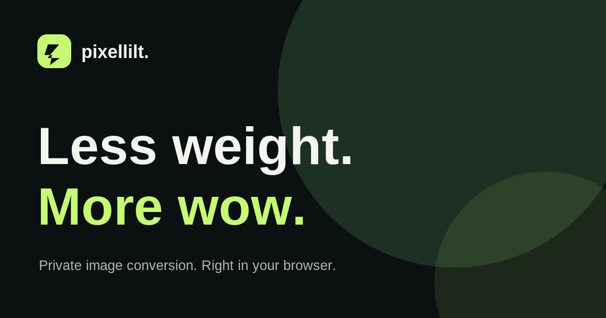

<div align="center">
  

  # PixelLilt Studio

  **Less weight. More wow.**

  Compress, resize, and convert images directly in your browser. No account, uploads, or trackers.

  [Run locally](#run-locally) · [Features](#features) · [Deploy](docs/DEPLOYMENT.md) · [Contribute](CONTRIBUTING.md)
</div>



## Features

- **Private by design** — conversion happens entirely on your device through browser APIs. Images aren't sent to a server.
- **Batch processing** — queue up to 20 images, then download each result or a ZIP archive.
- **Flexible exports** — create WebP, JPEG, or PNG files, choose quality, and resize without upscaling.
- **Actual file sizes** — compare originals with outputs, including when conversion produces a larger file.
- **Instant demo** — try the editor with an image generated locally in your browser.
- **Installable and offline-capable** — a small progressive web app (PWA) shell caches application files after the first visit.
- **No runtime dependencies** — plain HTML, CSS, and JavaScript. No framework, tracking SDK, or external font.

## Run locally

**Requirements:** Node.js 20 or later.

```bash
npm ci
npm run dev
```

Open **http://localhost:4173**.

## Build and test

```bash
npm run verify
```

This runs syntax checks, the automated tests, and builds a static website in `dist/`. GitHub Actions runs the same checks on commits and pull requests.

For hosting, see the [deployment guide](docs/DEPLOYMENT.md). Cloudflare Pages and Netlify support the included `_headers` security configuration.

## Supported formats

| Input | Output |
| --- | --- |
| JPEG, PNG, WebP, AVIF, GIF, BMP¹ | WebP, JPEG, PNG² |

¹ Input must be supported by your browser's image decoder. Animated images export as a still frame.  
² WebP output requires browser encoder support. PNG is lossless-encoded but an export can still alter metadata, profiles, or transparency if converted to another format.

Limitations: maximum 20 files per batch, 30 MiB per file, 150 MiB per batch, and 50 megapixels per source image. Large image processing consumes local memory. JPEG exports replace transparency with white. Compression savings vary and aren't guaranteed.

## Privacy and security

PixelLilt has no image upload endpoint, user accounts, analytics, third-party runtime scripts, or database. Image processing uses built-in browser APIs; the service worker caches application assets only, not your images.

Do not treat the app as a forensic anonymization tool: images may contain identifying visual content. Review the [security policy](SECURITY.md) for threat-model details and private vulnerability reporting.

## Contributing

Contributions, accessibility improvements, and reproducible bug reports are welcome. Read [CONTRIBUTING.md](CONTRIBUTING.md) and the [code of conduct](CODE_OF_CONDUCT.md). Please include the browser and input format when reporting conversion problems.

## License

[MIT](LICENSE) © 2026 PixelLilt Studio contributors.
